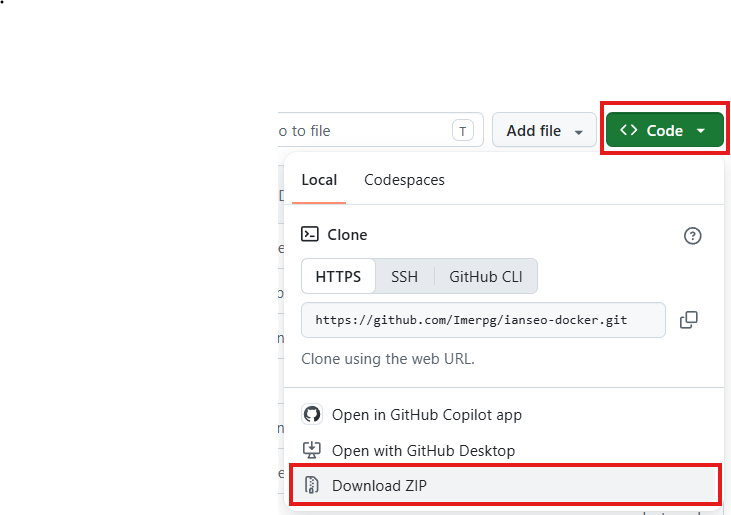

<p align="center">
  
</p>

# Ianseo Docker

> **Une solution clé en main pour déployer Ianseo en 3 étapes, même sans compétences en informatique !**

Ianseo Docker est un outil qui installe automatiquement **Ianseo** (le logiciel de référence pour la gestion de compétitions de tir à l'arc) sur votre ordinateur, **sans aucune configuration manuelle**.

Tout fonctionne dans des conteneurs (des environnements isolés) grâce à Docker, ce qui garantit que votre ordinateur reste propre et que l'application fonctionne du premier coup.

> **En bref :** Docker s'occupe de l'installation, et Ianseo est prêt à l'emploi en quelques minutes.

---

## Table des matières

- [Prérequis](#prérequis)
- [Installation rapide (3 étapes)](#installation-rapide-3-étapes)    
- [Première utilisation](#première-utilisation)
- [Mise à jour](#mise-à-jour)
- [Questions fréquentes (FAQ)](#questions-fréquentes-faq)
- [Dépannage](#dépannage)
- [À propos d'Ianseo](#à-propos-dianseo)
- [Licence et crédits](#licence-et-crédits)

---

## Prérequis

### 🐳 Installer Docker

Docker est indispensable pour exécuter cet installateur.

#### Sur Windows 10/11

1. Téléchargez Docker Desktop depuis le [site officiel de Docker](https://www.docker.com/products/docker-desktop/).
2. Installez-le en suivant les instructions (conservez les options par défaut).
3. Redémarrez votre ordinateur si nécessaire.
4. Lancez Docker Desktop (attendez que le statut indique *Running*).

#### Sur macOS

1. Téléchargez Docker Desktop depuis le [site officiel de Docker](https://www.docker.com/products/docker-desktop/).
2. Installez l'application puis lancez-la.

#### Sur Linux (Ubuntu/Debian)

Ouvrez un terminal et exécutez :

```sh
sudo apt update && sudo apt install docker.io docker-compose-v2 -y
sudo systemctl enable --now docker
```

Pour vérifier que Docker est correctement installé, tapez :

```sh
docker --version
```

---

## Installation rapide (3 étapes)

### 1️⃣ Télécharger le projet

Ouvrez un terminal et exécutez :

```sh
git clone https://github.com/Imerpg/ianseo-docker.git ianseo-docker
cd ianseo-docker
```

*Si vous ne souhaitez pas utiliser Git :*
- Téléchargez l'archive ZIP du projet depuis GitHub.
- Décompressez-la dans le dossier de votre choix.
- Ouvrez un terminal dans ce dossier.



### 2️⃣ Configurer (facultatif)

Le projet fonctionne directement avec les paramètres par défaut. Pour personnaliser la configuration :

1. Dupliquez le fichier d'exemple :

```sh
cp .env-prod .env
```

2. Éditez le fichier `.env` avec un éditeur de texte :
   - `IANSEO_VERSION` : Version d'Ianseo à installer (format : `AAAAMMJJ`, ex. : `20250210`).
   - `WEB_PORT` : Port d'accès web (par défaut : `80`).
   - `MYSQL_ROOT_PASSWORD` : Mot de passe administrateur de la base de données.
   - `MYSQL_DATABASE` : Nom de la base de données (par défaut : `ianseo`).
   - `MYSQL_USER` : Nom d'utilisateur de la base de données (par défaut : `ianseo`).
   - `MYSQL_PASSWORD` : Mot de passe utilisateur de la base de données.

> 🔐 **Sécurité :** Avant le premier démarrage, pensez à remplacer `MYSQL_ROOT_PASSWORD` et `MYSQL_PASSWORD` par des mots de passe forts.

### 3️⃣ Démarrer Ianseo

Dans le terminal, lancez (copier coller) :

```sh
docker compose up -d --build
```

Docker réalise automatiquement les opérations suivantes :
1. Téléchargement des composants d'Ianseo.
2. Initialisation de la base de données MySQL.
3. Configuration automatique des services.
4. Démarrage de l'application.

*Durée estimée : entre 1 secondes et 5 minutes selon le pc.*

> ✅ **Mise à jour automatique :** Le système vérifie et applique automatiquement la dernière version d'Ianseo à chaque démarrage.

---

## Première utilisation

### Accéder à Ianseo

Une fois le démarrage terminé, ouvrez votre navigateur web à l'adresse suivante :

**[http://localhost/ianseo/](http://localhost/ianseo/)**

> 💡 *Note :* N'oubliez pas d'inclure le `/` final dans l'URL.

---

## Mise à jour

Pour appliquer la dernière version d'Ianseo, exécutez la commande suivante (copier coller) :

```sh
docker compose down && docker compose up -d --build
```

---

## Questions fréquentes (FAQ)

### Q : Je reçois l'erreur « port already in use »

R : Le port `80` est déjà utilisé par une autre application. Modifiez la variable `WEB_PORT` dans le fichier `.env` :

```env
WEB_PORT=8080
```

Accédez ensuite à l'application via : [http://localhost:8080/ianseo/](http://localhost:8080/ianseo/)

### Q : Comment arrêter Ianseo ?

R : Dans le dossier du projet, exécutez (copier coller) :

```sh
docker compose down
```

### Q : Comment redémarrer Ianseo ?

R : 
(copier coller)
```sh
docker compose restart
```

*(Ou `docker compose down && docker compose up -d --build` si vous souhaitez aussi reconstruire les conteneurs).*

### Q : Où sont stockées mes données ?

R : Les données de la base de données et les fichiers sont enregistrés dans des volumes Docker persistants. Elles restent conservées même après l'arrêt des conteneurs.

### Q : Comment réinitialiser complètement l'installation ?

R : ⚠️ **Attention : cette action supprime définitivement toutes vos données.**

```sh
docker compose down -v
docker compose up -d --build
```

---

## Dépannage

### Docker n'est pas reconnu ou ne répond pas

- **Windows / macOS :** Vérifiez que Docker Desktop est bien lancé et actif.
- **Linux :** Assurez-vous que votre utilisateur appartient au groupe `docker` :

```sh
sudo usermod -aG docker $USER
```

*Déconnectez-vous puis reconnectez-vous pour appliquer ce changement.*

### L'accès à `http://localhost/ianseo/` échoue

1. Assurez-vous que le service Docker est en cours d'exécution.
2. Patientez 1 à 2 minutes après le lancement initial.
3. Vérifiez les journaux d'erreurs avec la commande : `docker compose logs -f`

---

## À propos d'Ianseo

### Qu'est-ce qu'Ianseo ?

Ianseo est le logiciel open source de référence pour l'organisation et la gestion des compétitions de tir à l'arc. Utilisé à l'échelle internationale, il est conforme aux règlements officiels de World Archery.

Fonctionnalités principales :
- Gestion des inscriptions et des tireurs
- Planification des départs et cibles
- Saisie et calcul automatique des scores
- Édition des résultats, classements et feuilles de marque

Site officiel : [ianseo.net](https://ianseo.net)

### Pourquoi utiliser cette version Docker ?

L'installation classique d'Ianseo nécessite l'administration d'un serveur web (Apache/Nginx), la configuration d'une base de données MySQL et la gestion de modules PHP. Cet installateur encapsule l'ensemble de ces dépendances pour un déploiement immédiat.

---

## Licence et crédits

Ce projet est distribué sous licence **GNU GPL v3.0**. Consultez le fichier `LICENSE` pour plus de détails.

### Crédits

- **Ianseo** : Développé par l'équipe Ianseo et soutenu par World Archery.
- **Ianseo Docker** : Proposé par [Imerpg](https://github.com/Imerpg) pour simplifier le déploiement.

*Note : Ce projet est une initiative indépendante et n'est ni affilié ni officiel auprès de l'équipe Ianseo ou de World Archery.*